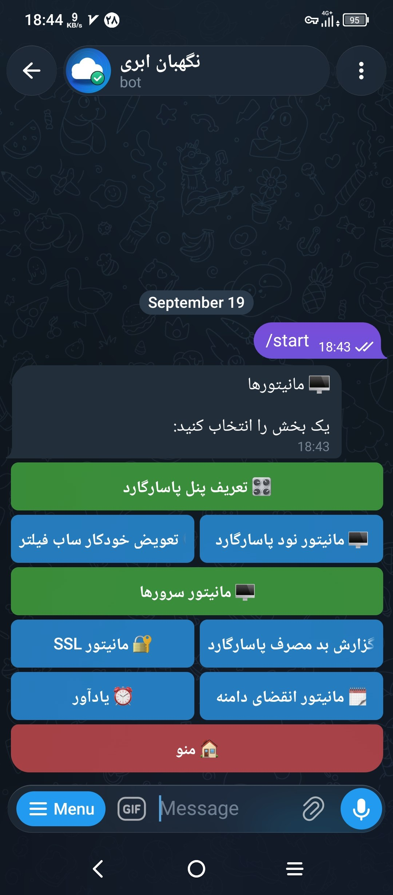
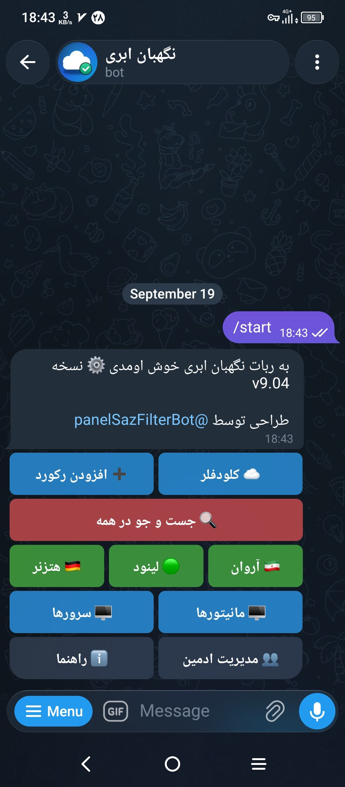
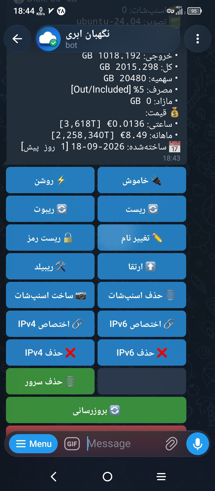

# نگهبان ابری ☁️

<p align="center">
  <a href="https://t.me/openWEBcode" target="_blank"></a>
</p>


مدیریت کامل **دامنه، DNS، پنل پاسارگارد و سرورها (هتزنر، آروان)** در تلگرام.

این پروژه **دو نسخهٔ مستقل** دارد:

| نسخه | اجرا روی | مناسب برای | وضعیت |
|---|---|---|---|
| 🚀 **سروری (Go)** | VPS خودت (systemd) | استفادهٔ جدی، کامل، سریع، کم‌مصرف | **پیشنهادی** |
| ☁️ **ورکر (Cloudflare)** | Cloudflare Workers | بدون سرور، مصرف کم | سبک (بخشی از قابلیت‌ها حذف شده) |

---

<p align="center">
  
  
  
</p>

## کدام نسخه را نصب کنم؟

- **نسخهٔ سروری (Go)** — یک ربات کامل روی VPS خودت؛ **بدون Cloudflare Worker**. همهٔ قابلیت‌ها فعال، دیتابیس SQLite محلی، رم ~۲۰ مگابایت. اگر سرور داری، این را نصب کن.
- **نسخهٔ ورکر** — بدون نیاز به سرور، فقط روی Cloudflare Workers. برای کسانی که سرور ندارند. **توجه:** قابلیت «هشدار انقضا و حجم» که عمدتاً روی Workers KV نوشتارِ زیاد داشت از این نسخه **حذف** شده؛ اگر آن را می‌خواهی از نسخهٔ سروری استفاده کن.

---

# 🚀 نسخهٔ سروری (Go) — پیشنهادی

## پیش‌نیازها
| # | مورد | راهنما |
|---|---|---|
| ۱ | یک سرور لینوکسی (VPS) با دسترسی root | — |
| ۲ | توکن ربات تلگرام | [@BotFather](https://t.me/BotFather) → `/newbot` |
| ۳ | شناسهٔ عددی تلگرام خودت | [@userinfobot](https://t.me/userinfobot) |
| ۴ | توکن API کلادفلر (اختیاری برای DNS) | در پایین توضیح داده شده |

## نصب
روی سرور (با root) اجرا کن:

```bash
bash -c "$(curl -sL https://raw.githubusercontent.com/Aknuun/cloud-guardian/main/install-server.sh)"
```

اسکریپت خودش:
- پیش‌نیازها و **Go** را نصب می‌کند،
- سورس را از گیت‌هاب می‌گیرد و **کامپایل** می‌کند،
- توکن ربات، آیدی ادمین و توکن کلادفلر را می‌پرسد،
- یک سرویس **systemd** می‌سازد و اجرا می‌کند.

## مدیریت

```bash
bash install-server.sh status      # وضعیت سرویس
bash install-server.sh logs        # لاگ‌ها
bash install-server.sh update      # به‌روزرسانی
bash install-server.sh uninstall   # حذف
# یا مستقیماً:
systemctl status cg-server
journalctl -u cg-server -f
```

> ربات با long-polling کار می‌کند؛ نیازی به دامنه یا وب‌هوک نیست. فایل‌ها در `/opt/cloud-guardian` هستند (`config.json`، `data.db`).

## 🛟 پشتیبان فیلور (Standby) — فقط نسخهٔ سروری

اگر سرورت قطع شود، می‌توانی یک **ورکر کلادفلر پشتیبان** داشته باشی که موقتاً جای ربات را بگیرد تا سرور برگردد — کاملاً خودکار و از داخل خود ربات:

- در **تنظیمات → 🛟 پشتیبان فیلور** (یا پیشنهاد خودکار در اولین `/start`) روی «راه‌اندازی» بزن.
- یک **توکن کلادفلر** با ۸ دسترسی زیر بده (همان توکنی که برای نسخهٔ ورکری لازم است):

  **اجباری:** `Account · Workers Scripts · Edit` · `Account · Workers KV Storage · Edit` · `Zone · DNS · Edit` · `Zone · Zone Settings · Edit`
  **اختیاری:** `Zone · Email Routing Rules · Edit` · `Account · Email Routing Addresses · Edit` · `Zone · Analytics · Read` · `Account · Account Analytics · Read`
  > Account Resources = All accounts · Zone Resources = All zones

- ربات خودش یک **اسم تازه** (مثل `cg-failover-xxxx`) می‌سازد تا با ورکرهای قبلی قاطی نشود، ورکر را دپلو می‌کند، یک KV و کرون ۵ دقیقه‌ای می‌سازد و آدرس را ذخیره می‌کند.
- برای health check ورکر باید سرور را با **هاستنیم** ببیند، چون ورکر کلادفلر به آی‌پی خام وصل نمی‌شود (خطای `1003`). ربات خودش یک رکورد **DNS-only** (ابر خاکستری) مثل `cg-failover.<اولین دامنهٔ فعال اکانت>` می‌سازد و به آی‌پی سرور اشاره می‌دهد؛ پس **نیازی به رله نیست**. اگر `public_url` یک هاست‌نیم باشد، همان استفاده می‌شود. پیش‌فرض = اولین دامنهٔ اکانت.
- در حالت عادی، سرور با polling کار می‌کند و **وب‌هوک حذف است**. کرون ورکر هر ۵ دقیقه سلامت سرور را چک می‌کند؛ اگر سرور ~۲ بار پشت‌سرهم جواب نداد، **وب‌هوک را به خودش می‌برد** و نسخهٔ ورکری (تقریباً کامل، با KV محلی که از اعتبارنامه‌های سرور همگام می‌شود) جواب می‌دهد؛ به محض برگشت سرور، وب‌هوک را آزاد می‌کند.
- از همان صفحه می‌توانی **وضعیت** (سالم/قطع/فعال‌بودن فیلور)، **تنظیم مجدد**، **غیرفعال‌کردن** یا **حذف کامل** کنی.

> **مهاجرت از نسخهٔ ورکری:** اگر قبلاً ورکر داشتی، هنگام استارت سرور وب‌هوک کهنه پاک می‌شود تا polling کار کند؛ ورکرِ قدیمی را هم می‌توانی از **«🧹 پاک‌سازی ورکرهای قبلی»** انتخاب و کرون/اسکریپتش را غیرفعال یا حذف کنی تا با سرور نجنگد.

---

# ☁️ نسخهٔ ورکر (Cloudflare Workers) — بدون سرور

## پیش‌نیازها
| # | مورد | راهنما |
|---|---|---|
| ۱ | توکن API کلادفلر | در پایین توضیح داده شده |
| ۲ | توکن ربات تلگرام | [@BotFather](https://t.me/BotFather) |
| ۳ | شناسهٔ عددی تلگرام خودت | [@userinfobot](https://t.me/userinfobot) |

**توکن کلادفلر — فقط ۱ بار تیک بزن:** https://dash.cloudflare.com/profile/api-tokens → `Create Custom Token`

**اجباری (۴ تا):**
- [x] **Account** → `Workers Scripts` → **Edit**
- [x] **Account** → `Workers KV Storage` → **Edit**
- [x] **Zone** → `DNS` → **Edit**
- [x] **Zone** → `Zone Settings` → **Edit**

**اختیاری (۴ تا):** `Email Routing Rules` · `Email Routing Addresses` · `Analytics (Zone)` · `Account Analytics`
> Account Resources = **All accounts** · Zone Resources = **All zones**

## نصب
روی هر ماشین لینوکسی (فقط به‌عنوان ابزار نصب):

```bash
bash -c "$(curl -sL https://raw.githubusercontent.com/Aknuun/cloud-guardian/main/install.sh)"
```

> بعد از نصب می‌توانی سرور را حذف کنی؛ ربات روی Cloudflare مستقل اجرا می‌شود.
> نکته: قابلیت **هشدار انقضا و حجم (وبهوک پاسارگارد)** در این نسخه حذف شده است.

> **🪶 حالت سبک (Lite):** این نسخه به‌صورت پیش‌فرض با بایندینگ `CG_LITE=1` نصب می‌شود؛ یعنی **بدون رله و بدون ایجنت**. در این حالت پنل/مانیتور نود پاسارگارد، گاردین، مانیتورهای سنگین (سرور، SSL، انقضای دامنه، هاست‌فیلتر) و همهٔ کرون‌های دوره‌ایِ سنگین **خاموش‌اند** تا مصرف Workers KV نزدیک صفر شود. فقط بخش‌های سبک فعال‌اند: کلودفلر، هتزنر/لینود/آروان، ایمیل دامنه، یادآورها، لود بالانسر، تنظیمات/راهنما. برای قابلیت‌های کامل از **نسخهٔ سروری (Go)** استفاده کن.

---

## قابلیت‌ها (هر دو نسخه، مگر موارد یادشده)

```text
🏠 منوی اصلی
├── ➕ افزودن رکورد · ☁️ کلودفلر ── دامنه‌ها ── رکوردها (ویرایش/حذف · SSL · Proxy · TTL)
├── ⚡ تغییر سریع · 🔍 جست‌وجو در همه ── ⭐ ساب‌های منتخب · 🗂 عملیات گروهی
├── 🇩🇪 هتزنر · 🟢 لینود · 🇮🇷 آروان ── ساخت/حذف سرور · اسنپ‌شات · آی‌پی
├── 🖥 سرورها و مانیتورینگ ── SSH، آمار CPU/RAM/دیسک، هشدار  (فقط نسخهٔ سروری)
├── 🎛 پنل پاسارگارد ── 🔁 چرخش روزانه ساب‌ها · ✏️ ویرایش پنل · 💾 بکاپ هاست‌ها  (فقط نسخهٔ سروری)
├── 🧭 تعویض خودکار ساب فیلتر (هاست‌فیلتر)  (فقط نسخهٔ سروری)
├── 📡 مانیتور نود پاسارگارد  (فقط نسخهٔ سروری) · 💬 ایمیل دامنه · ⚖️ لود بالانسر IP
├── ⏰ یادآورها · 🔐 مانیتور SSL  (فقط نسخهٔ سروری) · 🗓 انقضای دامنه  (فقط نسخهٔ سروری) · 📊 ترافیک ساب‌ها  (فقط نسخهٔ سروری)
└── ⚙️ تنظیمات و راهنما ── 🛟 پشتیبان فیلور · 👥 ادمین‌ها · 📊 آمار نصب‌ها · 📢 پیام همگانی · هاب
```

<details>
<summary align="right" dir="rtl"><b>جزئیات بیشتر</b></summary>

<div align="right" dir="rtl">
<b>☁️ کلودفلر</b><br>
➕ افزودن اکانت · ➕ دامنه · ➕ رکورد · ✏️ تغییر مقدار/نام/نوع · ⏱ TTL · 🔄 Proxy · 🔒 SSL/TLS · 🗂 عملیات گروهی · ⭐ منتخب‌ها · 🗑 حذف رکورد/دامنه/اکانت<br><br>

<b>🇩🇪 هتزنر / 🟢 لینود</b><br>
➕ ساخت سرور · ⚡ روشن · 🔌 خاموش · 🔄 ریبوت · 🛠 ریبیلد · ⬆️ ارتقا · 🔓 ریست رمز · 📷 اسنپ‌شات · 🌐 آی‌پی‌ها · ➕ اکانت<br><br>

<b>🇮🇷 آروان (دامنه + سرور ابری)</b><br>
🌐 دامنه‌ها · 📋 رکوردها · 🛡 امنیت (فایروال/WAF/SSL) · 🖥 سرورها (به‌تفکیک ریجن) · ➕ ساخت سرور · ⚡/🔌/🔄 · 📷 اسنپ‌شات · 📷 اسنپ‌شات‌ها · ✏️ نام · 🔑 ریست رمز · 🗑 حذف · ➕ اکانت<br><br>

<b>✨ ویژه</b><br>
🧭 تعویض خودکار هاست فیلتر — دامنهٔ فیلترشده را با دامنهٔ شماره‌دار جدید برای همان IP جایگزین می‌کند (REALITY: فقط address).<br>
🔁 چرخش روزانه ساب‌ها — هر اجرا فیلدهای منتخب هر هاست یک ساب‌دامنهٔ تازه می‌گیرند + بازگردانی.<br>
📡 مانیتور نود · 🔐 مانیتور SSL · 🗓 انقضای دامنه · 📊 ترافیک ساب‌ها · ⚖️ لود بالانسر · ✉️ ایمیل دامنه<br>
<b>🔔 هشدار انقضا و حجم</b> (وبهوک پاسارگارد) — <b>فقط نسخهٔ سروری</b> (در ورکر به‌خاطر مصرف KV حذف شد).<br><br>

<b>⚙️ مدیریت</b> — 👥 ادمین‌ها · 📊 آمار نصب‌ها/هاب · 📢 پیام همگانی · 📞 ارتباط با سازنده · 🔄 نسخه‌ها و آپدیت
</div>
</details>

---

## ساختار مخزن

```
cloud-guardian/
├── server/                 # 🚀 نسخهٔ سروری (Go)
│   ├── cmd/ · internal/    #    سورس کامل
│   ├── config.example.json #    نمونهٔ تنظیمات
│   └── VERSION
├── install-server.sh       # نصب‌کنندهٔ نسخهٔ سروری (Go + systemd)
├── worker.js               # ☁️ نسخهٔ ورکر (Cloudflare)
├── install.sh              # نصب‌کنندهٔ نسخهٔ ورکر
└── ...
```

---

ساخته شده با ❤️ برای کسانی که کار روزمرهٔ مدیریت دامنه و سرور را به تلگرام سپرده‌اند.
